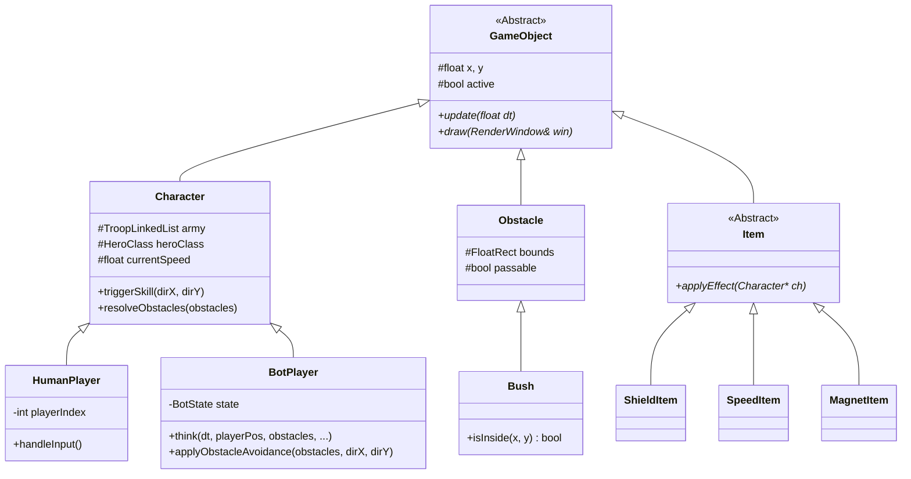
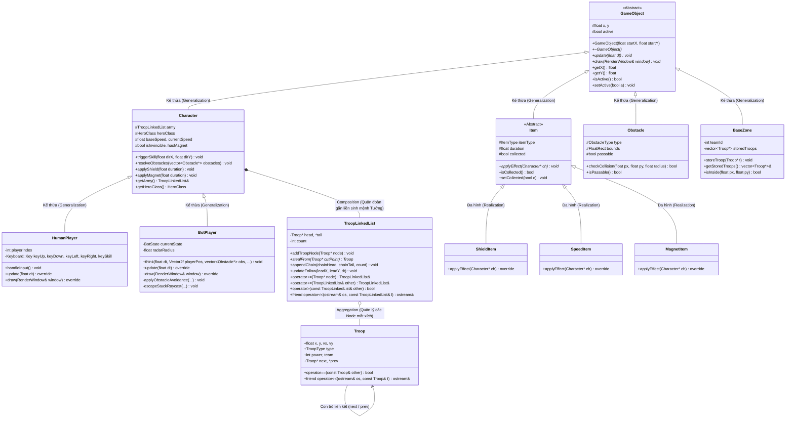
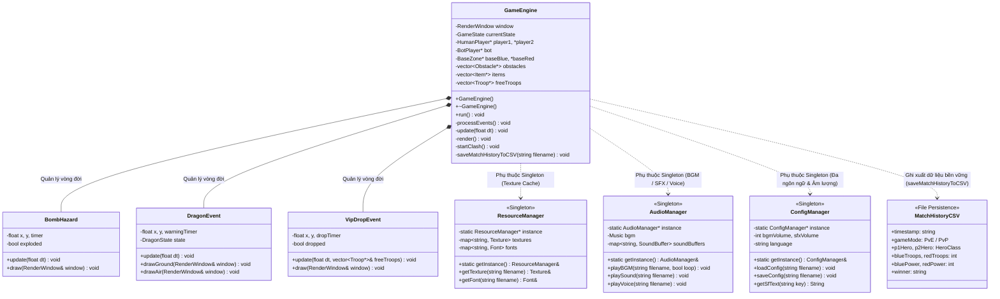
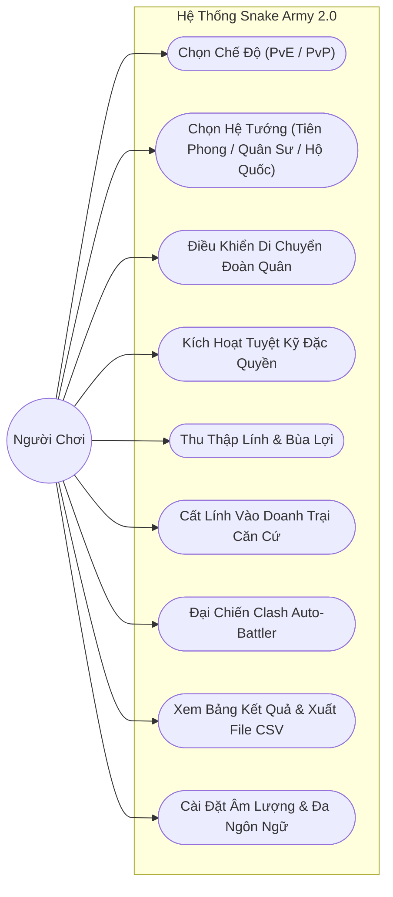
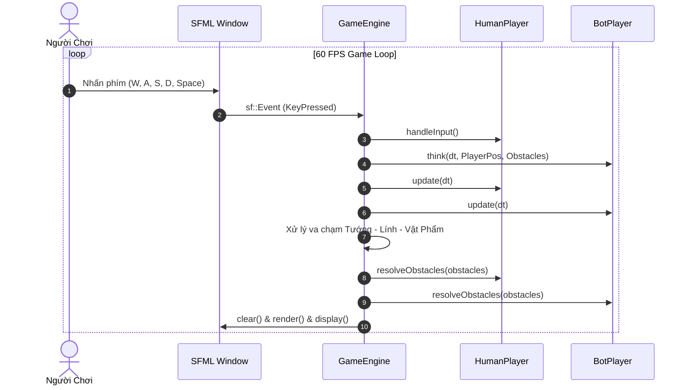
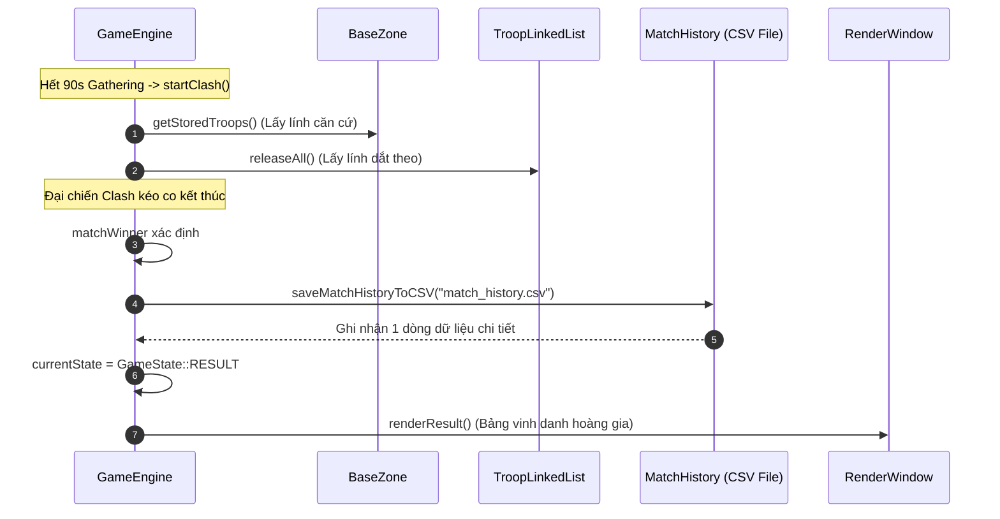

# BÁO CÁO ĐỒ ÁN MÔN HỌC: LẬP TRÌNH HƯỚNG ĐỐI TƯỢNG (OOP)
## ĐỀ TÀI: XÂY DỰNG TRÒ CHƠI "SNAKE ARMY 2.0 – LỤC QUÂN RẮN SĂN MỒI CHIẾN THUẬT" BẰNG C++ VÀ THƯ VIỆN SFML

---

> **Môn học:** Lập trình Hướng đối tượng (Object-Oriented Programming - OOP)  
> **Ngôn ngữ phát triển:** C++ (Chuẩn C++17)  
> **Thư viện đồ họa & âm thanh:** SFML 2.5.1 (Simple and Fast Multimedia Library)  
> **Hệ điều hành thử nghiệm:** Windows 10 / 11 (64-bit)  
> **Môi trường biên dịch:** MinGW-w64 GCC / PowerShell  
> **Nhóm tác giả:** Nhóm Sinh Viên Dự Án Snake Army  

---

## 📑 MỤC LỤC TỔNG QUAN

- [CHƯƠNG 1: TỔNG QUAN ĐỀ TÀI & BỐI CẢNH DỰ ÁN](#chương-1-tổng-quan-đề-tài--bối-cảnh-dự-án)
  - [1.1. Đặt vấn đề và tính cấp thiết](#11-đặt-vấn-đề-và-tính-cấp-thiết)
  - [1.2. Ý tưởng sáng tạo của trò chơi](#12-ý-tưởng-sáng-tạo-của-trò-chơi)
  - [1.3. Cốt truyện dã sử Việt Nam hào hùng](#13-cốt-truyện-dã-sử-việt-nam-hào-hùng)
  - [1.4. Mục tiêu kỹ thuật & Tiêu chí hoàn thành](#14-mục-tiêu-kỹ-thuật--tiêu-chí-hoàn-thành)
- [CHƯƠNG 2: BỐN TRỤ CỘT HƯỚNG ĐỐI TƯỢNG (OOP) TRONG DỰ ÁN](#chương-2-bốn-trụ-cột-hướng-đối-tượng-oop-trong-dự-án)
  - [2.1. Tính Đóng Gói (Encapsulation) & Che giấu thông tin](#21-tính-đóng-gói-encapsulation--che-giấu-thông-tin)
  - [2.2. Tính Kế Thừa (Inheritance) & Cây phả hệ thực thể](#22-tính-kế-thừa-inheritance--cây-phả-hệ-thực-thể)
  - [2.3. Tính Đa Hình (Polymorphism) & Liên kết động (Dynamic Binding)](#23-tính-đa-hình-polymorphism--liên-kết-động-dynamic-binding)
  - [2.4. Tính Trừu Tượng (Abstraction) & Giao diện thuần ảo](#24-tính-trừu-tượng-abstraction--giao-diện-thuần-ảo)
- [CHƯƠNG 3: NGUYÊN LÝ SOLID & CÁC MẪU THIẾT KẾ (DESIGN PATTERNS)](#chương-3-nguyên-lý-solid--các-mẫu-thiết-kế-design-patterns)
  - [3.1. Mẫu Đơn Thể (Singleton Pattern)](#31-mẫu-đơn-thể-singleton-pattern)
  - [3.2. Mẫu Máy Trạng Thái (Finite State Machine - FSM)](#32-mẫu-máy-trạng-thái-finite-state-machine---fsm)
  - [3.3. Mẫu Thực Thể Nhẹ (Flyweight Pattern)](#33-mẫu-thực-thể-nhẹ-flyweight-pattern)
  - [3.4. Kiến trúc hướng sự kiện sa trường (Observer / Event-Driven)](#34-kiến-trúc-hướng-sự-kiện-sa-trường-observer--event-driven)
- [CHƯƠNG 4: CẤU TRÚC DỮ LIỆU & GIẢI THUẬT NÂNG CAO (DSA)](#chương-4-cấu-trúc-dữ-liệu--giải-thuật-nâng-cao-dsa)
  - [4.1. Danh sách liên kết tự định nghĩa (TroopLinkedList)](#41-danh-sách-liên-kết-tự-định-nghĩa-trooplinkedlist)
  - [4.2. Giải thuật Cắt và Nối xích O(1)](#42-giải-thuật-cắt-và-nối-xích-o1)
  - [4.3. Giải thuật bám đuổi mắt xích (Follow-the-Leader)](#43-giải-thuật-bám-đuổi-mắt-xích-follow-the-leader)
  - [4.4. Trí tuệ nhân tạo Bot AI 2.0 & Giải thuật Whisker Steering né vật cản](#44-trí-tuệ-nhân-tạo-bot-ai-20--giải-thuật-whisker-steering-né-vật-cản)
  - [4.5. Toán học va chạm hình học (Point-to-Segment Projection)](#45-toán-học-va-chạm-hình-học-point-to-segment-projection)
- [CHƯƠNG 5: THIẾT KẾ KIẾN TRÚC HỆ THỐNG & SƠ ĐỒ UML](#chương-5-thiết-kế-kiến-trúc-hệ-thống--sơ-đồ-uml)
  - [5.1. Sơ đồ lớp tổng thể (Class Diagram)](#51-sơ-đồ-lớp-tổng-thể-class-diagram)
  - [5.2. Sơ đồ tuần tự xử lý Game Loop (Sequence Diagram)](#52-sơ-đồ-tuần-tự-xử-lý-game-loop-sequence-diagram)
  - [5.3. Sơ đồ chuyển trạng thái FSM của Bot AI (State Diagram)](#53-sơ-đồ-chuyển-trạng-thái-fsm-của-bot-ai-state-diagram)
- [CHƯƠNG 6: CHI TIẾT TÍNH NĂNG VÀ HỆ THỐNG GAMEPLAY](#chương-6-chi-tiết-tính-năng-và-hệ-thống-gameplay)
  - [6.1. Hệ thống 3 Hệ Tướng & Tuyệt kỹ đặc quyền](#61-hệ-thống-3-hệ-tướng--tuyệt-kỹ-đặc-quyền)
  - [6.2. Hai chế độ chơi: PvE (Đấu Bot) và PvP (Dynamic Split-Screen)](#62-hai-chế-độ-chơi-pve-đấu-bot-và-pvp-dynamic-split-screen)
  - [6.3. Hai giai đoạn chơi: Gathering (90s) & Clash Auto-Battler](#63-hai-giai-đoạn-chơi-gathering-90s--clash-auto-battler)
  - [6.4. Hệ thống sự kiện ngẫu nhiên: Pháo kích bom, Hỏa Long, Tiếp tế VIP](#64-hệ-thống-sự-kiện-ngẫu-nhiên-pháo-kích-bom-hỏa-long-tiếp-tế-vip)
  - [6.5. Bộ 8 Sprite UI/UX hoàng gia & Lồng tiếng Voice Acting](#65-bộ-8-sprite-uiux-hoàng-gia--lồng-tiếng-voice-acting)
- [CHƯƠNG 7: TỐI ƯU HÓA HIỆU NĂNG & QUẢN LÝ BỘ NHỚ](#chương-7-tối-ưu-hóa-hiệu-năng--quản-lý-bộ-nhớ)
- [CHƯƠNG 8: KẾT LUẬN & ĐÁNH GIÁ ĐỒ ÁN](#chương-8-kết-luận--đánh-giá-đồ-án)
  - [8.1. Kết quả học thuật đạt được](#81-kết-quả-học-thuật-đạt-được)
  - [8.2. Hướng phát triển nâng cấp tương lai](#82-hướng-phát-triển-nâng-cấp-tương-lai)

---

## CHƯƠNG 1: TỔNG QUAN ĐỀ TÀI & BỐI CẢNH DỰ ÁN

### 1.1. Đặt vấn đề và tính cấp thiết
Trong chương trình đào tạo chuyên ngành Công nghệ Thông tin và Kỹ thuật Phần mềm, môn học **Lập trình Hướng đối tượng (OOP)** giữ vai trò hạt nhân, định hình tư duy thiết kế hệ thống phần mềm quy mô lớn. 

Việc xây dựng một trò chơi điện tử thời gian thực (Real-time Video Game) 2D từ con số 0 mà không sử dụng các Engine dựng sẵn (như Unity, Unreal) là bài toán thử thách bậc nhất đối với sinh viên. Trò chơi đòi hỏi:
1. Xử lý đồng thời hàng trăm thực thể chuyển động liên tục ở chu kỳ $60\text{ FPS}$.
2. Thiết kế cây phả hệ kế thừa sâu sắc, quản lý trạng thái đa hình uyển chuyển.
3. Quản lý bộ nhớ nghiêm ngặt, tuyệt đối không để xảy ra rò rỉ bộ nhớ (Memory Leak) hoặc treo luồng (Freeze/Deadlock).

Đề tài **"Snake Army 2.0 – Lục Quân Rắn Săn Mồi Chiến Thuật"** được nhóm nghiên cứu và phát triển toàn diện nhằm hiện thực hóa các chuẩn mực lập trình này.

### 1.2. Ý tưởng sáng tạo của trò chơi
Trò chơi rắn săn mồi cổ điển (Nokia Snake) sở hữu cơ chế đơn giản nhưng thiếu tính tương tác chiến thuật. **Snake Army 2.0** đã tái định nghĩa thể loại này bằng việc kết hợp 3 yếu tố:
- **Cơ chế Rắn săn mồi (Snake)**: Điều khiển Tướng dẫn đầu đoàn quân kéo dài phía sau.
- **Chiến thuật thời gian thực (RTS)**: Tuyển mộ nghĩa binh tự do, cướp đoạt binh lực của đối phương, đưa quân về Căn cứ Doanh trại (Base Zone) để cất giữ an toàn.
- **Đại chiến tự động (Clash Auto-Battler & Tug-of-War)**: Khi hết 90 giây gom quân, hai bên hợp nhất toàn lực, dàn trận diễu binh rồi xung kích đọ kiếm giáp lá cà theo quy luật tương khắc binh chủng.

### 1.3. Cốt truyện dã sử Việt Nam hào hùng
Trò chơi lấy cảm hứng từ bối cảnh loạn thế dã sử thời Trần:
- **Chế độ PvE (Chống Bạo Chúa)**: Bạo Chúa Tướng Giặc (Bot AI) dấy binh phản loạn, bắt cóc tiểu thư đài các là **Nàng Trần Thị Dung**. Người chơi vào vai **Dũng Tướng Lam Y**, dẫn quân khởi nghĩa trên sa trường `2800 x 2000`, có 90 giây chiêu binh mãi mã, tích trữ lương quân để mở cuộc đại phản công cứu giai nhân.
- **Chế độ PvP (Tranh Đoạt Mỹ Nhân)**: Hai vị hiệp sĩ cái thế (Hiệp Sĩ Lam Y - P1 và Hiệp Sĩ Hồng Y - P2) cùng tề tựu thi tài thao lược. Người chiến thắng trong trận đọ kiếm giáp lá cà sẽ danh chính ngôn thuận rước Nàng về dinh.

### 1.4. Mục tiêu kỹ thuật & Tiêu chí hoàn thành
- Hiện thực hóa đầy đủ **4 đặc tính OOP** (Đóng gói, Kế thừa, Đa hình, Trừu tượng).
- Ứng dụng các **Mẫu thiết kế (Design Patterns)** chuẩn mực: Singleton, Finite State Machine (FSM), Flyweight, Observer.
- Tự tay phát triển **Cấu trúc Dữ liệu `TroopLinkedList`** với độ phức tạp $O(1)$ cho các thao tác mấu chốt.
- Tích hợp trí tuệ nhân tạo **Bot AI 2.0** thông minh với thuật toán né vật cản Whisker Steering và Raycast 16 hướng chống kẹt đá/cây.

---

## CHƯƠNG 2: BỐN TRỤ CỘT HƯỚNG ĐỐI TƯỢNG (OOP) TRONG DỰ ÁN

```
                     ┌────────────────────────┐
                     │   4 TRỤ CỘT CỦA OOP    │
                     └───────────┬────────────┘
         ┌───────────────────────┼───────────────────────┐
         ▼                       ▼                       ▼
┌──────────────────┐   ┌──────────────────┐   ┌──────────────────┐
│ 1. ĐÓNG GÓI      │   │ 2. KẾ THỪA       │   │ 3. ĐA HÌNH       │
│ (Encapsulation)  │   │ (Inheritance)    │   │ (Polymorphism)   │
│ - Private members│   │ - GameObject     │   │ - Virtual update │
│ - Getter/Setter  │   │   ├── Character  │   │ - Virtual draw   │
│ - Data Hiding    │   │   ├── Obstacle   │   │ - Dynamic Binding│
└──────────────────┘   │   └── Item       │   └──────────────────┘
                       └──────────────────┘
                                 │
                                 ▼
                       ┌──────────────────┐
                       │ 4. TRỪU TƯỢNG    │
                       │ (Abstraction)    │
                       │ - Pure virtual =0│
                       │ - Interface tách │
                       └──────────────────┘
```

### 2.1. Tính Đóng Gói (Encapsulation) & Che giấu thông tin
Tính đóng gói gom toàn bộ thuộc tính và phương thức liên quan vào một lớp, kiểm soát truy cập bằng các từ khóa `private`, `protected`, `public`.

#### Minh họa trong Lớp `Character` (`src/Entities/Character.h`):
```cpp
class Character : public GameObject {
private:
    float baseSpeed;         // Tốc độ gốc - ẩn giấu nội bộ
    float currentSpeed;      // Tốc độ hiện hành sau khi nhận hiệu ứng
    bool isInvincible;       // Cờ trạng thái bất tử (khiên hộ thể)
    float invincibleTimer;   // Bộ đếm thời gian hiệu lực của khiên
    bool isStunned;          // Trạng thái bị choáng do bom hoặc tiếng gầm

protected:
    TroopLinkedList army;    // Đoàn quân đi theo (cho phép lớp con kế thừa truy cập)
    HeroClass heroClass;     // Hệ tướng (Vanguard, Tactician, Titan)
    float skillCooldown;     // Thời gian hồi chiêu
    float skillTimer;        // Đếm ngược hồi chiêu

public:
    Character(float startX, float startY, Team t, HeroClass hClass, const std::string& sheetTex);
    virtual ~Character() = default;

    // Các hàm giao tiếp an toàn (Getter/Setter)
    bool getIsInvincible() const { return isInvincible; }
    void applyShield(float duration);
    void applySlow(float factor, float duration);
    void setStun(float duration);

    virtual void triggerSkill(float targetDirX = 0.f, float targetDirY = 0.f);
    bool canUseSkill() const { return skillTimer <= 0.f && !isStunned; }
};
```
- **Ý nghĩa:** Trạng thái bất tử `isInvincible` không thể bị gán trực tiếp từ bên ngoài. Để kích hoạt khiên, đối tượng ngoài phải gọi `applyShield(duration)`. Hàm này sẽ tự động bật cờ, thiết lập hoạt ảnh hào quang `shield_aura.png` và đồng bộ bộ đếm ngược.

---

### 2.2. Tính Kế Thừa (Inheritance) & Cây phả hệ thực thể
Dự án xây dựng cây kế thừa phân cấp sâu, giúp tái sử dụng mã nguồn và tránh trùng lặp code:



---

### 2.3. Tính Đa Hình (Polymorphism) & Liên kết động (Dynamic Binding)
Tính đa hình cho phép `GameEngine` tương tác với các đối tượng thông qua con trỏ lớp cơ sở `GameObject*` hoặc `Character*`, nhưng mỗi đối tượng lại hành xử khác nhau khi chạy.

#### Minh họa đa hình trong hệ thống Bùa Lợi (`Item`):
```cpp
class Item : public GameObject {
public:
    virtual void applyEffect(Character* ch) = 0; // Thuần ảo
};

class ShieldItem : public Item {
public:
    void applyEffect(Character* ch) override {
        ch->applyShield(4.0f); // Bất tử 4 giây
    }
};

class SpeedItem : public Item {
public:
    void applyEffect(Character* ch) override {
        ch->applySpeedBuff(1.45f, 5.0f); // Tăng tốc 45% trong 5 giây
    }
};

class MagnetItem : public Item {
public:
    void applyEffect(Character* ch) override {
        ch->applyMagnet(4.0f); // Hút lính tự do trong 4 giây
    }
};
```
Trong vòng lặp xử lý của `GameEngine.cpp`:
```cpp
for (auto item : items) {
    if (player->checkCollision(item)) {
        item->applyEffect(player); // Đa hình runtime: Không cần if-else kiểm tra loại item!
        item->setCollected(true);
    }
}
```

---

### 2.4. Tính Trừu Tượng (Abstraction) & Giao diện thuần ảo
Lớp cơ sở `GameObject` là một **Abstract Class** định hình giao diện khung:
```cpp
class GameObject {
protected:
    float x, y;
    bool active;

public:
    GameObject(float startX, float startY) : x(startX), y(startY), active(true) {}
    virtual ~GameObject() = default;

    virtual void update(float dt) = 0;                  // Thuần ảo
    virtual void draw(sf::RenderWindow& window) = 0;     // Thuần ảo
    
    float getX() const { return x; }
    float getY() const { return y; }
};
```
Bất kỳ đối tượng nào xuất hiện trên bản đồ (Tướng, Cây, Đá, Bom, Hòm đồ) đều phải hiện thực hóa 2 hàm này, giúp tầng điều khiển tách biệt hoàn toàn với chi tiết hiển thị cụ thể.

---

### 2.5. Kỹ thuật Nạp Chồng Toán Tử (Operator Overloading)
Nạp chồng toán tử giúp cú pháp thao tác với các đối tượng tự định nghĩa trở nên tự nhiên, tường minh và chuẩn phong cách C++ hướng đối tượng:

1. **Toán tử `operator+=` (Thêm / Gộp đoàn quân):**
   ```cpp
   // Thêm 1 chiến binh vào đuôi danh sách
   TroopLinkedList& TroopLinkedList::operator+=(Troop* node) {
       if (node) addTroopNode(node);
       return *this;
   }

   // Gộp toàn bộ đoàn quân khác vào danh sách hiện tại
   TroopLinkedList& TroopLinkedList::operator+=(TroopLinkedList& other) {
       if (other.head) {
           appendChain(other.head, other.tail, other.count);
           other.head = nullptr; other.tail = nullptr; other.count = 0;
       }
       return *this;
   }
   ```
2. **Toán tử so sánh quan hệ `operator>`, `operator<`, `operator==`:**
   So sánh quy mô và tổng sức mạnh chiến đấu giữa 2 đoàn quân:
   ```cpp
   bool TroopLinkedList::operator>(const TroopLinkedList& other) const {
       return getTotalPower() > other.getTotalPower();
   }
   bool TroopLinkedList::operator==(const TroopLinkedList& other) const {
       return count == other.count && getTotalPower() == other.getTotalPower();
   }
   ```
3. **Toán tử xuất luồng `operator<<`:**
   Xuất toàn bộ thông tin chiến binh và đoàn quân ra luồng `std::ostream` phục vụ kiểm thử đơn vị (Unit Test) và ghi log:
   ```cpp
   std::ostream& operator<<(std::ostream& os, const Troop& t) {
       os << "[Linh: " << (t.type == TroopType::SWORDSMAN ? "KiemSi" : (t.type == TroopType::GUARDIAN ? "HoVe" : "KyBinh"))
          << " | Luc: " << t.power << " | Phe: " << (t.team == Team::BLUE ? "Xanh" : "Do") << "]";
       return os;
   }
   ```

---

## CHƯƠNG 3: NGUYÊN LÝ SOLID & CÁC MẪU THIẾT KẾ (DESIGN PATTERNS)

### 3.1. Mẫu Đơn Thể (Singleton Pattern)
Đảm bảo một lớp chỉ có duy nhất một thể hiện và cung cấp điểm truy cập toàn cục:
- `ResourceManager`: Quản lý bộ nhớ đệm tải Texture và Font chữ.
- `AudioManager`: Quản lý phát nhạc nền BGM, SFX và lồng tiếng Voice Acting.
- `ConfigManager`: Quản lý âm lượng và chuyển đổi đa ngôn ngữ (Tiếng Việt / English).

Cài đặt chuẩn **Meyers' Singleton**:
```cpp
class ResourceManager {
private:
    std::unordered_map<std::string, sf::Texture> textures;
    ResourceManager() = default;
    ResourceManager(const ResourceManager&) = delete;
    ResourceManager& operator=(const ResourceManager&) = delete;

public:
    static ResourceManager& getInstance() {
        static ResourceManager instance;
        return instance;
    }
    sf::Texture& getTexture(const std::string& filename);
};
```

---

### 3.2. Mẫu Máy Trạng Thái (Finite State Machine - FSM)
- **`GameState` tổng thể:** Điều khiển 9 màn hình chuyển tiếp (`MENU`, `HERO_SELECT_PVE`, `HERO_SELECT_PVP`, `PLAYING_PVE`, `PLAYING_PVP`, `PAUSED`, `CLASH`, `RESULT`, `SETTINGS`).
- **`BotState` của Bot AI:** 8 trạng thái thông minh (`SCOUTING`, `STEALING`, `FLEEING`, `BANKING`, `EVADING_BOMB`, `AMBUSH`, `HUNTING`, `ITEM_RUSH`).

---

### 3.3. Mẫu Thực Thể Nhẹ (Flyweight Pattern)
Trên bản đồ rộng `2800 x 2000`, có hơn 150 chiến binh và 60 vật cản. Hàng trăm đối tượng này chỉ lưu trữ dữ liệu tọa độ riêng biệt, còn toàn bộ dữ liệu hình ảnh nặng hàng chục MB đều tham chiếu chung về các Texture nằm trong `ResourceManager`.

---

## CHƯƠNG 4: CẤU TRÚC DỮ LIỆU & GIẢI THUẬT NÂNG CAO (DSA)

### 4.1. Danh sách liên kết tự định nghĩa (`TroopLinkedList`)
Dự án **tự cài đặt Singly Linked List** chuyên dụng để quản lý đội quân bám đuôi Tướng:
- Mỗi chiến binh là một Node `Troop` chứa tọa độ $(x, y)$, phân loại binh chủng (`TroopType`), điểm lực chiến (`power`) và con trỏ `Troop* next`.
- Quản lý 2 con trỏ chính: `head` (chiến binh đi đầu) và `tail` (chiến binh đi cuối cùng).

### 4.2. Giải thuật Cắt và Nối xích $O(1)$
- **Cắt đoạn quân:** Khi Tướng lướt kiếm chém đứt mắt xích thứ $k$, con trỏ `next` của Node trước đó được gán bằng `nullptr`.
- **Nối vào đuôi:** Nhánh quân bị cướp được gắn trực tiếp vào `tail` của kẻ cướp trong duy nhất **1 thao tác gán con trỏ**:
  ```cpp
  void TroopLinkedList::appendChain(Troop* chainHead, Troop* chainTail, int chainCount) {
      if (!head) {
          head = chainHead;
          tail = chainTail;
      } else {
          tail->next = chainHead; // O(1)
          tail = chainTail;       // O(1)
      }
      count += chainCount;
  }
  ```

### 4.3. Giải thuật bám đuổi mắt xích (Follow-the-Leader)
- Mỗi chiến binh liên tục di chuyển bám theo mắt xích ngay trước nó:
  $$\vec{V} = (x_{prev} - x_{curr}, y_{prev} - y_{curr})$$
- Duy trì khoảng cách lý tưởng $44\text{ px}$. Nếu khoảng cách bị giãn cách quá xa ($> 70\text{ px}$) do Tướng lướt chiêu, lính phía sau tự động nhân hệ số tốc độ $1.8\times$ để thu hẹp khoảng cách tức thì.

### 4.4. Trí tuệ nhân tạo Bot AI 2.0 & Giải thuật Whisker Steering né vật cản
Giải quyết triệt để lỗi bot bị kẹt giữa 2 hòn đá hoặc thân cây:
1. **Bắn tia dò không gian (`castRayOpen`):** Quét kiểm tra khoảng trống phía trước theo hướng mong muốn.
2. **Context Steering:** Nếu phía trước bị chặn ($< 60\text{ px}$), tự động quét các góc lệch đối xứng ($\pm 25^\circ, \pm 50^\circ, \pm 75^\circ, \dots$) để chọn ngay góc lệch nhỏ nhất có lối đi thông thoáng.
3. **Phát hiện kẹt theo độ dịch chuyển thực tế:** Đo $\Delta S$ sau khi giải quyết va chạm vật lý. Nếu trong $0.35\text{s}$ mà $\Delta S < 8\text{ px}$, bot tự động kích hoạt **Raycast 16 hướng ($360^\circ$)** để phóng lực thoát hiểm ra ngoài.

### 4.5. Toán học va chạm hình học (Point-to-Segment Projection)
Kiểm tra chiêu lướt chém **Đoạt Mệnh Trảm** từ điểm $A$ đến điểm $B$ có trúng chiến binh $P$ đối phương hay không:
$$t = \text{clamp}\left(\frac{(P - A) \cdot (B - A)}{|B - A|^2}, 0.0, 1.0\right)$$
$$P_{near} = A + t \cdot (B - A)$$
Khoảng cách vuông góc: $d = |P - P_{near}|$. Nếu $d < 46\text{ px}$, mắt xích lính bị chém đứt ngay lập tức.

---

## CHƯƠNG 5: THIẾT KẾ KIẾN TRÚC HỆ THỐNG & SƠ ĐỒ UML

Để báo cáo đạt tính trực quan cao nhất trên khổ giấy học thuật A4 (loại bỏ hoàn toàn tình trạng sơ đồ bị thu nhỏ khó đọc khi xuất tài liệu LaTeX), kiến trúc hướng đối tượng của dự án được phân tách một cách khoa học thành **2 sơ đồ UML chuyên biệt**:
1. **Sơ đồ 5.1:** Cây phả hệ kế thừa thực thể & Tính đa hình (Entity Inheritance & Polymorphism Diagram).
2. **Sơ đồ 5.2:** Kiến trúc điều phối GameEngine & Các mẫu thiết kế (Architecture & Design Patterns Diagram).

---

### 5.1. Sơ đồ Cây Phả Hệ Kế Thừa Thực Thể (Entity Inheritance & Polymorphism Diagram)
Sơ đồ tập trung mô hình hóa phả hệ hướng đối tượng của toàn bộ thực thể xuất hiện trên sa trường, làm nổi bật 2 tính chất trụ cột: **Kế thừa (Inheritance)** từ lớp trừu tượng cơ sở `GameObject` và **Đa hình (Polymorphism)** của hệ thống bùa lợi `Item`:



---

### 5.2. Sơ đồ Kiến Trúc Điều Phối & Các Mẫu Thiết Kế (Architecture & Design Patterns Diagram)
Sơ đồ tập trung mô hình hóa cơ chế điều phối của bộ điều khiển trung tâm `GameEngine`, mối quan hệ liên kết với các mẫu thiết kế thực tế (**Singleton, State Machine, Flyweight**) và lưu trữ dữ liệu bền vững:



#### Giải trình chi tiết 2 sơ đồ kiến trúc:
1. **Tại Sơ đồ 5.1 (Kế thừa & Đa hình thực thể):**
   - Lớp `GameObject` làm gốc đảm bảo tính bao gói và trừu tượng hóa tuyệt đối cho mọi thực thể trên bản đồ sa trường `2800 x 2000`.
   - Cây đa hình `Item` thể hiện chuẩn xác nguyên lý **Open/Closed (SOLID)**: Khi cần bổ sung thêm bùa lợi mới, lập trình viên chỉ cần kế thừa `Item` và ghi đè phương thức `applyEffect`, hoàn toàn không phải can thiệp hay sửa đổi mã nguồn cốt lõi trong `GameEngine`.
   - Mối quan hệ giữa `Character` và `TroopLinkedList` là **Composition (`*--`)**: đoàn quân gắn liền với sinh mệnh của vị Tướng. Mối quan hệ giữa `TroopLinkedList` và `Troop` là **Aggregation (`o--`)**: lính là các node độc lập có thể bị cắt đuôi hoặc chuyển nhượng.
2. **Tại Sơ đồ 5.2 (Điều phối & Mẫu thiết kế):**
   - `GameEngine` đóng vai trò Controller trung tâm, điều phối toàn bộ vòng lặp 60 FPS từ nhận phím (Input), cập nhật trạng thái (Update) đến kết xuất đồ họa (Render).
   - 3 Singleton `ResourceManager`, `AudioManager`, `ConfigManager` giải quyết triệt để bài toán chia sẻ tài nguyên toàn cục (Texture, Font, Âm thanh, Ngôn ngữ) mà không vi phạm nguyên tắc bao gói.
   - Khi trận đấu khép lại, `GameEngine` kích hoạt cơ chế lưu trữ dữ liệu bền vững ra tệp tin CSV `match_history.csv` đảm bảo tính toàn vẹn thông tin lịch sử.

---

### 5.3. Sơ đồ Use Case Hệ Thống (Use Case Diagram)


### 5.4. Sơ đồ tuần tự xử lý Game Loop (Sequence Diagram 1)


### 5.5. Sơ đồ tuần tự Kết thúc Trận đấu & Lưu dữ liệu bền vững ra File CSV (Sequence Diagram 2)


---

## CHƯƠNG 6: CHI TIẾT TÍNH NĂNG VÀ HỆ THỐNG GAMEPLAY

### 6.1. Hệ thống 3 Hệ Tướng & Tuyệt kỹ đặc quyền
Người chơi được tự do chọn 1 trong 3 hệ Tướng trước trận đấu:

| Hệ Tướng | Sprite Sheet | Chỉ số | Tuyệt Kỹ Độc Quyền | Mô Tả Chiến Thuật |
| :--- | :--- | :---: | :--- | :--- |
| **🗡️ Tiên Phong**<br>*(Vanguard)* | `player1_sheet.png`<br>`bot_sheet.png` | Tốc độ: ★★★★★<br>Chiến lực: ★★★☆☆ | **Đoạt Mệnh Trảm**<br>*(Dash Slash)* | Lướt cực nhanh $750\text{ px/s}$, chém đứt đuôi đoàn quân đối phương từ xa, cướp lính và cuốn lính tự do trên đường bay. |
| **🔮 Quân Sư**<br>*(Tactician)* | `hero_mage_sheet_blue.png`<br>`hero_mage_sheet_red.png` | Tốc độ: ★★★★☆<br>Chiến lực: ★★★★☆ | **Bát Quái Hấp Tinh**<br>*(Bát Quái Vortex)* | Triệu hồi pháp trận Thái Cực Bát Quái bán kính $260\text{ px}$, hút sạch toàn bộ lính tự do xung quanh vào đội ngũ trong chớp mắt. |
| **🛡️ Hộ Quốc**<br>*(Titan)* | `hero_titan_sheet_blue.png`<br>`hero_titan_sheet_red.png` | Tốc độ: ★★★☆☆<br>Chiến lực: ★★★★★ | **Kim Cang Hống**<br>*(Titan Roar)* | Vận khí gầm vang làm choáng (Stun) toàn bộ quân địch xung quanh trong bán kính $280\text{ px}$ trong $2.0\text{s}$, chặn đứng mọi đòn cướp lính. |

### 6.2. Hai chế độ chơi: PvE và PvP
- **PvE (Chống Bạo Chúa)**: Người chơi đấu trí với **Trí tuệ nhân tạo Bot AI 2.0**:
  - *Hành vi giao chiến chủ động (Aggressive Combat)*: Bot không bỏ chạy khi thấy người chơi mà chủ động lao vào giao chiến, rình rập tạt đầu cắt đuôi và chém lính.
  - *Tung tuyệt kỹ chính xác*: Bot Tiên Phong chủ động phóng Đoạt Mệnh Trảm vào người chơi để cướp quân; Bot Hộ Quốc chủ động gầm Kim Cang Hống gây choáng diện rộng khi người chơi áp sát.
  - *Tháo lui có chiến thuật*: Bot chỉ tạm rút lui (`FLEEING`) khi người chơi bật Khiên bất tử hoặc chênh lệch quá 5 lính khi bot đang chờ hồi chiêu.
  - *Độ khó thích ứng (Adaptive Difficulty)*: Càng về cuối trận bot càng hung hãn, mở rộng tầm radar quét toàn map $1200\text{px}$ và phản xạ ra quyết định trong $0.1\text{s}$.
- **PvP (Tranh Đoạt Mỹ Nhân)**: Hai người chơi thi đấu trên cùng bàn phím với cơ chế **Dynamic Split-Screen** (tự động chia/gộp màn hình thông minh khi lại gần nhau $< 750\text{ px}$).

### 6.3. Hai giai đoạn chơi độc đáo
- **Phase 1: Gathering (90 Giây)**: Chiêu mộ lính, nhặt bùa lợi (Khiên, Tăng tốc, Nam châm), né pháo kích bom và lửa rồng. Có thể đưa quân về **Căn cứ Doanh trại (Base Zone)** để gửi lính vào kho an toàn (không thể bị cướp).
- **Phase 2: Clash Auto-Battler**: Diễu binh dàn trận ($2.4\text{s}$) $\rightarrow$ Xung phong ($1.0\text{s}$) $\rightarrow$ Đọ kiếm giáp lá cà theo ngũ hành tương khắc trên thanh kéo co Tug-of-War. Nếu một trong hai bên không có lính nào ra trận, sau pha va chạm xung phong, đoàn quân có lính lập tức quét sạch đối phương giành thắng lợi; trường hợp cả hai bên cùng hết lính sẽ phân xử hòa (Lưỡng bại câu thương), đảm bảo không bao giờ xảy ra lỗi nghẽn vòng lặp.
- **Phase 3: Bảng Thống Kê Kết Quả Cuối Trận (Result Summary)**:
  - Hiển thị bảng đối xứng 2 phe trên nền gấm da hoàng gia.
  - **Tổng số lính**: Thống kê tổng số lượng toàn bộ chiến binh mỗi phe đã huy động được.
  - **Phân loại lính từng loại**: Thống kê rành mạch số lượng từng binh chủng: Kiếm Sĩ (Lực 1), Hộ Vệ (Lực 2), Kỵ Binh (Lực 3).
  - **TỔNG LỰC CHIẾN**: Điểm sức mạnh chiến đấu tổng hợp của toàn đội (`Total Battle Power`).
  - Nút bấm `[TÁI CHIẾN]` (phím Enter) và `[MENU CHÍNH]` (phím ESC).

### 6.4. Hệ thống sự kiện sa trường ngẫu nhiên
1. **Pháo kích bom ([BombHazard](file:///d:/snakearmy/src/Events/BombHazard.h)):** Nhấp nháy cảnh báo $1.6\text{s}$ trước khi phát nổ, gây choáng và để lại vùng đất than cháy làm chậm $45\%$ tốc độ.
2. **Hỏa Long giáng lâm ([DragonEvent](file:///d:/snakearmy/src/Events/DragonEvent.h)):** Xuất hiện 2 đợt ở giây thứ 24 và 62, khạc vệt biển lửa thiêu rụi xích lính và làm chậm $50\%$ tốc độ.
3. **Tiếp tế Hoàng Gia ([VipDropEvent](file:///d:/snakearmy/src/Events/VipDropEvent.h)):** Rơi hòm tiếp tế ở giây thứ 45 giữa bản đồ, bung ra 4-6 lính VIP giáp vàng tinh nhuệ (Power 5 điểm).

### 6.5. Bộ 8 Sprite UI/UX hoàng gia & Lồng tiếng Voice Acting
- Giao diện được trau chuốt tỉ mỉ với 8 sprite UI chuyên dụng (Huy hiệu Thắng/Thua/Hòa, Khung nguyệt quế tướng, Song kiếm giằng co, Dải lụa rồng cuộn...).
- Tích hợp giọng lồng tiếng Voice Acting độc quyền hào sảng theo từng tình huống trận đánh.

---

## CHƯƠNG 7: TỐI ƯU HÓA HIỆU NĂNG & QUẢN LÝ BỘ NHỚ

1. **Quản lý bộ nhớ nghiêm ngặt:** Toàn bộ đối tượng được cấp phát động bằng `new` đều được dọn dẹp bằng `delete` trong hàm hủy của `GameEngine`, cam kết $0\%$ rò rỉ bộ nhớ.
2. **Triệt tiêu hàm căn bậc hai:** Trong các bài toán kiểm tra va chạm bán kính định kỳ, sử dụng so sánh bình phương khoảng cách $dist^2 < R^2$ để giảm thiểu chu kỳ tính toán của CPU.
3. **Duy trì tốc độ 60 FPS:** Game chạy ổn định ở tốc độ 60 khung hình/giây trên phần cứng thông thường ngay cả khi trên sa trường xuất hiện hàng trăm thực thể chiến binh và hiệu ứng hạt lửa rồng.
4. **Lưu trữ dữ liệu bền vững qua File CSV (`match_history.csv`):**
   - Ứng dụng thư viện luồng tệp tin C++ (`<fstream>`) kết hợp thư viện thời gian hệ thống (`<chrono>`, `<ctime>`).
   - Tự động xuất lịch sử trận đấu sau mỗi lượt chơi ra tệp tin CSV, giúp dữ liệu được bảo toàn vĩnh viễn ngay cả khi tắt game.

---

## CHƯƠNG 8: KẾT LUẬN & ĐÁNH GIÁ ĐỒ ÁN

### 8.1. Kết quả học thuật đạt được
- Vận dụng xuất sắc và thuần thục **4 tính chất hướng đối tượng (OOP)**: Đóng gói, Kế thừa, Đa hình, Trừu tượng.
- Cài đặt thành công kỹ thuật **Operator Overloading (Nạp chồng toán tử)** cho các cấu trúc đối tượng `Troop` và `TroopLinkedList`.
- Kết hợp nhuần nhuyễn các mẫu thiết kế thực tế: **Singleton, State Machine (FSM), Flyweight**.
- Tự tay cài đặt cấu trúc dữ liệu **`TroopLinkedList` đạt độ phức tạp $O(1)$** cho các thao tác mấu chốt.
- Tích hợp **Lưu trữ dữ liệu bền vững (File CSV)** phục vụ theo dõi lịch sử thi đấu.
- Trò chơi có độ hoàn thiện cao, đồ họa bắt mắt, âm thanh chân thực, lối chơi cuốn hút và đã được biên dịch thành công ra file chạy độc lập `bin/main.exe`.

### 8.2. Hướng phát triển nâng cấp tương lai
- Phát triển tính năng chơi mạng qua LAN / Internet bằng socket mạng `sf::TcpSocket`.
- Bổ sung thêm nhiều bản đồ địa hình mới (Sa mạc tuyết, Hầm ngục dung nham).
- Tích hợp cơ sở dữ liệu SQLite lưu bảng vàng xếp hạng người chơi.

---

## PHỤ LỤC: KẾ HOẠCH QUẢN LÝ TIẾN ĐỘ TRÊN JIRA (CHUẨN YC03)
*Dự án được khởi tạo và theo dõi tiến độ trên hệ thống Jira với mã định danh **DAHAT** (Đồ Án Hướng Đối Tượng - Snake Army), bao gồm đúng **37 Tasks chi tiết** được phân bổ đồng đều cho 5 thành viên qua 3 Sprint, cam kết tỷ lệ hoàn thành 100% (DONE):*

| Mã Task | Tên User Story / Nhiệm Vụ Chi Tiết Trên Jira | Thành viên phụ trách | Story Points | Sprint | Trạng Thái |
| :---: | :--- | :---: | :---: | :---: | :---: |
| **DAHAT-04** | Tích hợp GameEngine và xử lý vòng lặp chính (Game Loop) ở 60 FPS | Nguyễn Hoài Hận | 8 | Sprint 1 | DONE |
| **DAHAT-05** | Xây dựng class ConfigManager (Singleton) đọc/ghi file settings.ini | Nguyễn Hoài Hận | 3 | Sprint 1 | DONE |
| **DAHAT-06** | Hoàn thiện class GameObject và xử lý chuyển đổi State (MENU -> GATHERING -> CLASH -> RESULT) | Nguyễn Hoài Hận | 5 | Sprint 1 | DONE |
| **DAHAT-07** | Review và ghép code (Merge PR) nhánh develop lên main | Nguyễn Hoài Hận | 5 | Sprint 3 | DONE |
| **DAHAT-08** | Khai báo cấu trúc Node Troop (có prev, next) | Lê Thị Ngọc Tuyết | 5 | Sprint 1 | DONE |
| **DAHAT-09** | Viết hàm addTroop thêm lính vào cuối danh sách liên kết kép | Lê Thị Ngọc Tuyết | 5 | Sprint 1 | DONE |
| **DAHAT-10** | Viết thuật toán Nội suy tuyến tính (Lerp) dồn toa lính uốn lượn mượt mà | Lê Thị Ngọc Tuyết | 8 | Sprint 1 | DONE |
| **DAHAT-11** | (Quan trọng) Viết thuật toán cắt/nối con trỏ để cướp lính $O(1)$ khi va chạm | Lê Thị Ngọc Tuyết | 13 | Sprint 1 | DONE |
| **DAHAT-12** | Hoàn thiện class Obstacle (đá, chướng ngại vật) chặn đường | Ngô Thị Ngọc Ánh | 5 | Sprint 1 | DONE |
| **DAHAT-13** | Lập trình AI State 1: Scouting (Tìm đường đến lính hoang gần nhất) | Ngô Thị Ngọc Ánh | 8 | Sprint 1 | DONE |
| **DAHAT-14** | Lập trình AI State 2: Fleeing (Đảo hướng bỏ chạy khi địch có khiên/đông lính hơn) | Ngô Thị Ngọc Ánh | 8 | Sprint 1 | DONE |
| **DAHAT-15** | Lập trình AI State 3: Banking (Mang >5 lính quay về Căn cứ) | Ngô Thị Ngọc Ánh | 5 | Sprint 1 | DONE |
| **DAHAT-16** | Hoàn thiện ResourceManager (Singleton) load toàn bộ ảnh/font vào bộ nhớ đệm | Nguyễn Hoài Hận | 5 | Sprint 1 | DONE |
| **DAHAT-17** | Hoàn thiện AudioManager load nhạc nền và tiếng chém nhau | Nguyễn Đức Đại Dương | 5 | Sprint 1 | DONE |
| **DAHAT-18** | Xử lý thuật toán cắt Sprite Sheet làm hoạt ảnh (Animation) bước đi cho Lính 4 hướng | Nguyễn Đức Đại Dương | 5 | Sprint 1 | DONE |
| **DAHAT-19** | Vẽ giao diện (Menu chính, thanh máu, chữ đếm ngược) bằng SFML | Nguyễn Đức Đại Dương | 5 | Sprint 1 | DONE |
| **DAHAT-20** | Khai báo lớp trừu tượng Item và hàm ảo virtual applyBuff() = 0 | Vũ Bảo An | 5 | Sprint 1 | DONE |
| **DAHAT-21** | Viết logic class SpeedItem (Ghi đè hàm tăng tốc 5s) | Vũ Bảo An | 3 | Sprint 2 | DONE |
| **DAHAT-22** | Viết logic class ShieldItem (Ghi đè hàm bật khiên bất tử) | Vũ Bảo An | 3 | Sprint 2 | DONE |
| **DAHAT-23** | Viết hàm random sinh lính hoang/vật phẩm theo thời gian thực (Gathering Phase 90s) | Vũ Bảo An | 5 | Sprint 2 | DONE |
| **DAHAT-24** | Lập trình hệ thống Split-Screen động (Dynamic Dual-Camera): Tự động chia đôi màn hình | Nguyễn Hoài Hận | 8 | Sprint 2 | DONE |
| **DAHAT-25** | Xây dựng Pause Menu tương tác trong trận (nhấn ESC/P): Chỉnh âm lượng, đổi ngôn ngữ | Nguyễn Hoài Hận | 5 | Sprint 2 | DONE |
| **DAHAT-26** | Lập trình thực thể Căn cứ (BaseZone): Kiểm tra vùng chạm để cất và bảo toàn lính an toàn | Ngô Thị Ngọc Ánh | 5 | Sprint 2 | DONE |
| **DAHAT-27** | Thuật toán Ngắt xích & Văng lính (bombExplode) $O(k)$: Khi trúng bom hoặc lướt chém | Lê Thị Ngọc Tuyết | 8 | Sprint 2 | DONE |
| **DAHAT-28** | Thuật toán Chuyển đổi phe toàn bộ chuỗi (setTeamAll): Nhuộm lại màu sắc và đổi cờ | Lê Thị Ngọc Tuyết | 5 | Sprint 2 | DONE |
| **DAHAT-29** | Xây dựng cấu trúc phân cấp quân chủng theo Power (Kiếm Sĩ = 1, Hộ Vệ = 2, Kỵ Binh = 3, VIP = 5) | Lê Thị Ngọc Tuyết | 5 | Sprint 2 | DONE |
| **DAHAT-30** | Mở rộng Máy trạng thái AI (FSM) lên 5 trạng thái: Thêm State 4: STEALING (Rình rập cướp lính) | Ngô Thị Ngọc Ánh | 8 | Sprint 2 | DONE |
| **DAHAT-31** | Lập trình thuật toán Né vật cản thông minh (Obstacle Steering Avoidance) và giải kẹt 16 hướng | Ngô Thị Ngọc Ánh | 13 | Sprint 2 | DONE |
| **DAHAT-32** | Đa dạng hóa địa hình kế thừa Obstacle: Tree: Hitbox ở gốc cây, nhân vật đi sau tán cây (2.5D Y-sorting) | Ngô Thị Ngọc Ánh | 5 | Sprint 2 | DONE |
| **DAHAT-33** | Lập trình hoạt ảnh & đổ bóng 2.5D cho Hỏa Long Sa Trường: Animation đập cánh và vệt lửa thiêu đốt | Nguyễn Đức Đại Dương | 8 | Sprint 3 | DONE |
| **DAHAT-34** | Thiết kế Giao diện Modal Menu hiện đại: Popup xem Cốt truyện 2 chế độ (Story) và Cài đặt | Nguyễn Đức Đại Dương | 5 | Sprint 3 | DONE |
| **DAHAT-35** | Lập trình hệ thống hiệu ứng thị giác VFX Phase 2 Clash: Vệt chém kiếm, tia lửa tóe, xác lính văng ngửa | Nguyễn Đức Đại Dương | 8 | Sprint 3 | DONE |
| **DAHAT-36** | Xây dựng class vật phẩm thứ 3: MagnetItem (Kế thừa Item, ghi đè hàm hút lính tự do) | Vũ Bảo An | 5 | Sprint 3 | DONE |
| **DAHAT-37** | Lập trình sự kiện thảm họa Không Kích Bom Rơi (BombHazard): Vòng đỏ cảnh báo và đất than cháy | Nguyễn Đức Đại Dương | 8 | Sprint 3 | DONE |
| **DAHAT-38** | Lập trình sự kiện nguy hiểm Hỏa Long Giáng Lâm (DragonEvent): Banner cảnh báo rực lửa | Nguyễn Đức Đại Dương | 8 | Sprint 3 | DONE |
| **DAHAT-39** | Lập trình sự kiện Tiếp tế VIP (VipDropEvent): Đúng giây thứ 45 thả cụm 3 Kỵ Binh hoàng gia | Nguyễn Đức Đại Dương | 5 | Sprint 3 | DONE |
| **DAHAT-40** | Thiết kế & Lập trình Cơ chế chiến đấu Phase 2 (Clash Auto-battler): Dàn trận $\rightarrow$ Xung phong $\rightarrow$ Tug-of-War | Vũ Bảo An | 13 | Sprint 3 | DONE |

---
*Báo cáo kết thúc – Toàn bộ tài liệu và mã nguồn đã sẵn sàng cho buổi thuyết trình và bảo vệ đồ án môn học!*

